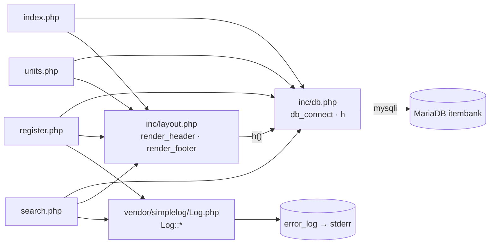

# legacy/item-bank-php 아키텍처

> 분석 범위: 진입점 · 의존 관계. 데이터 흐름 · 비즈니스 규칙은 아직 분석하지 않았다.
> 근거는 `파일:줄번호` 형식이며, 경로는 `legacy/item-bank-php/` 기준이다(compose 파일은 저장소 루트 기준).

## 1. 모듈 개요

- PHP 7.4 + Apache 위에서 도는 문항 은행 화면이다(`Dockerfile:1`). DB 는 mysqli 로 MariaDB `itembank` 에 붙는다(`Dockerfile:3`, `inc/db.php:14-21`).
- 화면은 홈 · 문항 검색 · 문항 등록 · 단원 목록 4개이고, 각 `.php` 파일이 URL 로 직접 호출되는 진입점이다(라우터 없음).
- 공통 코드는 `inc/db.php`(DB 연결 · HTML 이스케이프), `inc/layout.php`(머리말 · 꼬리말)이고, 로그는 `vendor/simplelog`(`error_log` 로 기록, `Log.php:52`)를 쓴다.
- 파일 8개 · 약 1,120줄이며, `search.php` 한 파일이 731줄이다.
- compose 에서 `8081:80` 으로 노출된다(`docker-compose.yml:39`).

## 2. 폴더 구조

```
legacy/item-bank-php/
├── Dockerfile               16줄   php:7.4-apache, mysqli, a2enmod rewrite
├── index.php                14줄   홈(메뉴)
├── search.php              731줄   문항 검색 (함수 4개 + 최상위 실행부)
├── register.php            177줄   문항 등록 (함수 없음, 최상위 스크립트)
├── units.php                48줄   단원 목록 (함수 없음, 최상위 스크립트)
├── inc/
│   ├── db.php               37줄   db_connect(), h()
│   └── layout.php           43줄   render_header(), render_footer()
└── vendor/
    └── simplelog/
        └── Log.php          54줄   외부 라이브러리(더미). 사용법만 확인
```

- 빌드 산출물 · 캐시 폴더는 없다.
- `.htaccess` 는 없다.

## 3. 진입점

URL 은 `Dockerfile:14`(`COPY . /var/www/html/`)와 `docker-compose.yml:39`(`8081:80`)를 근거로, 각 파일이 문서 루트에서 그대로 서비스된다고 보았다.

| URL · 화면 | 처음 실행되는 파일 | 주요 호출 (근거) |
|---|---|---|
| `/` 또는 `/index.php` · 홈(메뉴) | `index.php` | `render_header('홈')`(`index.php:5`) → 링크 3개 출력(`index.php:9-11`) → `render_footer()`(`index.php:14`) |
| `/search.php` · 문항 검색 (GET `q`, `unit`, `level`, `tag`, `sort`, `dir`, `page`, `search.php:5-12`) | `search.php` | `Log::setThreshold`(`:27`) → `render_header`(`:709`) → `db_connect`(`:713`) → `buildSearchQuery($_GET, $conn)`(`:722`) → `renderSearchForm`(`:723`) → `runSearchQuery`(`:724`) → `renderResultTable`(`:725`). 실패하면 `Log::error`(`:727`) → `render_footer`(`:731`) |
| `/register.php` · 문항 등록 (GET이면 폼, POST이면 저장, `register.php:40`) | `register.php` | `db_connect`(`:17`) → 단원 · 태그 목록 조회(`:27`, `:34`) → POST이면 검증(`:49-81`) → 트랜잭션으로 INSERT(`:85-114`) → `Log::info`·`Log::error`(`:115`, `:121`) → `render_header`(`:127`) → 폼 출력(`:141-175`) → `render_footer`(`:177`) |
| `/units.php` · 단원 목록 | `units.php` | `render_header`(`:5`) → `db_connect`(`:8`) → SQL 1개(`:16-20`) → 표 출력(`:33-46`) → `render_footer`(`:48`) |

- `register.php` 와 `units.php` 에는 함수 정의가 없다. 파일 전체가 위에서 아래로 한 번에 실행되는 스크립트다.
- `inc/*.php` 는 함수 정의만 있고 최상위 출력이 없다(`inc/db.php:7`, `:34`, `inc/layout.php:7`, `:38`).

## 4. 의존 관계

### 4.1 흐름도



화살표 방향은 "A → B (A 가 B 를 포함하거나 호출)" 이다.

### 4.2 파일 포함 (`require_once`)

| 포함하는 파일 → 포함되는 파일 | 근거 |
|---|---|
| `index.php` → `inc/db.php` | `index.php:2` |
| `index.php` → `inc/layout.php` | `index.php:3` |
| `units.php` → `inc/db.php` | `units.php:2` |
| `units.php` → `inc/layout.php` | `units.php:3` |
| `register.php` → `inc/db.php` | `register.php:2` |
| `register.php` → `inc/layout.php` | `register.php:3` |
| `register.php` → `vendor/simplelog/Log.php` | `register.php:4` |
| `search.php` → `inc/db.php` | `search.php:20` |
| `search.php` → `inc/layout.php` | `search.php:21` |
| `search.php` → `vendor/simplelog/Log.php` | `search.php:22` |

### 4.3 함수 호출 (파일 간)

| 호출하는 쪽 → 호출되는 쪽 | 호출 함수 | 근거 |
|---|---|---|
| `inc/layout.php` → `inc/db.php` | `h()` | `inc/layout.php:17`, `:33` |
| `search.php` → `inc/db.php` | `db_connect()` | `search.php:713` |
| `search.php` → `inc/db.php` | `h()` | `search.php:360`, `:416`, `:494`, `:674-678`, `:690` 등 |
| `search.php` → `inc/layout.php` | `render_header`, `render_footer` | `search.php:709`, `:717`, `:731` |
| `search.php` → `vendor/simplelog/Log.php` | `Log::setThreshold` | `search.php:27` |
| `search.php` → `vendor/simplelog/Log.php` | `Log::debug` | `search.php:103`, `:528` |
| `search.php` → `vendor/simplelog/Log.php` | `Log::error` | `search.php:537`, `:727` |
| `register.php` → `inc/db.php` | `db_connect` | `register.php:17` |
| `register.php` → `inc/db.php` | `h` | `register.php:20`, `:131`, `:144` 등 |
| `register.php` → `inc/layout.php` | `render_header` | `register.php:19`, `:127` |
| `register.php` → `inc/layout.php` | `render_footer` | `register.php:21`, `:177` |
| `register.php` → `vendor/simplelog/Log.php` | `Log::info` | `register.php:115` |
| `register.php` → `vendor/simplelog/Log.php` | `Log::error` | `register.php:121` |
| `units.php` → `inc/db.php` | `db_connect` | `units.php:8` |
| `units.php` → `inc/db.php` | `h` | `units.php:10`, `:40-43` |
| `units.php` → `inc/layout.php` | `render_header` | `units.php:5` |
| `units.php` → `inc/layout.php` | `render_footer` | `units.php:11`, `:23`, `:48` |
| `index.php` → `inc/layout.php` | `render_header` | `index.php:5` |
| `index.php` → `inc/layout.php` | `render_footer` | `index.php:14` |
| `vendor/simplelog/Log.php` → PHP 내장 | `error_log` (컨테이너 stderr, `Dockerfile:11`) | `Log.php:52` |

- `inc/layout.php` 는 `inc/db.php` 를 직접 포함하지 않는다. 호출하는 쪽이 `db.php` 를 먼저 포함해야 `h()` 가 동작하며, 네 화면 모두 `db.php` 를 먼저 포함한다(`index.php:2-3` 등).

### 4.4 `search.php` 내부 호출

| 호출하는 쪽 → 호출되는 쪽 | 근거 |
|---|---|
| 최상위 코드 → `buildSearchQuery` | `search.php:722` |
| 최상위 코드 → `renderSearchForm` | `search.php:723` |
| 최상위 코드 → `runSearchQuery` | `search.php:724` |
| 최상위 코드 → `renderResultTable` | `search.php:725` |

네 함수는 서로 호출하지 않는다. `buildSearchQuery` 가 돌려준 `$built` 배열을 나머지 세 함수에 넘기는 파이프라인 구조다(`search.php:722-725`).

### 4.5 DB 접근

모든 DB 접근은 `db_connect()` 가 돌려주는 mysqli 연결 하나를 공유한다(`inc/db.php:9-12` 의 static 캐시).

| 호출 위치 | 대상 | 근거 |
|---|---|---|
| `buildSearchQuery` | `unit` 조회 | `search.php:125`, `:156` |
| `buildSearchQuery` | `tag` 조회 | `search.php:178` |
| `runSearchQuery` | 건수 조회 | `search.php:577` |
| `runSearchQuery` | 목록 조회 | `search.php:600` |
| `register.php` | `unit` · `tag` 조회 | `register.php:27`, `:34` |
| `register.php` | `item` 채번 | `register.php:87` |
| `register.php` | `item` INSERT | `register.php:92-94` |
| `register.php` | `item_tag` INSERT | `register.php:105` |
| `units.php` | `unit` + `item` 서브쿼리 | `units.php:16-19` |

## 5. 가장 긴 함수 3개

모듈의 함수 정의는 14개다(`search.php` 4개, `inc/db.php` 2개, `inc/layout.php` 2개, `Log.php` 메서드 6개). 끝 라인은 함수를 닫는 `}` 기준이다.

| 순위 | 파일 · 함수 | 시작–끝 | 줄 수 | 하는 일 |
|---|---|---|---|---|
| 1 | `search.php` · `buildSearchQuery` | `:42`–`:564` | 523 | GET 파라미터로 검색 SQL · 건수 SQL · 바인딩 값을 만들고, 화면용 HTML 조각(요약 · 폼 입력 · 정렬 링크 · 경고)과 페이지 상태를 함께 반환한다(docblock `search.php:29-37`, 반환부 `:560-563`). |
| 2 | `search.php` · `renderResultTable` | `:647`–`:704` | 58 | 결과 건수 · 결과 표(id · title · unit_code · level · tag_names) · 페이지 링크를 출력한다(`search.php:655`, `:672-680`, `:684-703`). |
| 3 | `search.php` · `runSearchQuery` | `:571`–`:624` | 54 | `count_sql` 과 `sql` 을 prepared statement 로 실행해 `total` 과 `rows` 를 돌려준다(`search.php:577-597`, `:600-623`). |

다음으로 긴 함수는 `render_header`(`inc/layout.php:7-36`, 30줄), `db_connect`(`inc/db.php:7-29`, 23줄)다.

### 분석 중 눈에 띈 점

- `buildSearchQuery` 가 SQL 조립 · DB 조회 · HTML 생성을 한 함수에서 모두 한다(`search.php:125`, `:360`, `:455-494`).
- 검색 키워드를 원문 그대로 `Log::debug` 에 넘기지만(`search.php:103`), 로그 기준이 INFO 라서(`search.php:27`) 실제로 기록되지 않는다.
- `register.php` 는 AUTO_INCREMENT 가 아니라 `MAX(id)+1 ... FOR UPDATE` 로 새 id 를 만든다(`register.php:87`).
- `inc/db.php:14-18` 에 환경 변수가 없을 때 쓰는 접속 기본값이 리터럴로 있다(CLAUDE.md 에서 허용한 실습용 더미 `app-pass` 와 같은 값).

## 6. 미확인 목록

| 항목 | 이유 |
|---|---|
| `search.php:61-559`(`buildSearchQuery` 본문)의 분기 흐름 | 본문을 읽지 않고 호출 패턴만 grep 으로 찾았다 |
| `buildSearchQuery` 안의 `unit` · `tag` 조회(`search.php:125`, `:156`, `:178`)가 실행되는 조건 | 위와 같음 |
| `a2enmod rewrite`(`Dockerfile:4`) 외의 Apache 설정 | 모듈 안에 설정 파일이 없고 기본 이미지 설정을 확인하지 않았다 |
| `inc/*.php` · `vendor/*` 를 URL 로 직접 열 수 있는지 | 서버 설정을 확인하지 않았다 |
| 데이터 흐름 · 비즈니스 규칙 전반 | 아직 분석 단계에 들어가지 않았다 |
