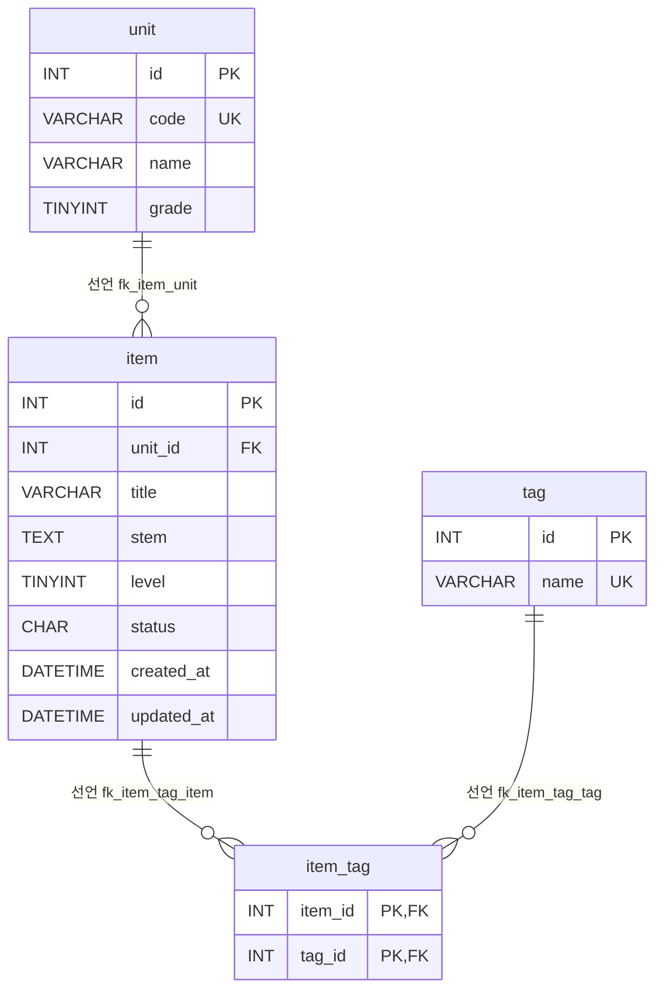

# legacy/item-bank-php 데이터 흐름 · ERD

> 분석 범위: 이 모듈이 쓰는 테이블 · 뷰, 테이블 관계, 읽기 · 쓰기 위치.
> 근거는 `파일:줄번호` 형식이다. PHP 파일은 `legacy/item-bank-php/` 기준, 스키마는 `db/mariadb/init/` 기준이다.
> 진입점 · 의존 관계는 [ARCHITECTURE.md](ARCHITECTURE.md) 를 본다.

## 1. 테이블 목록

스키마 정의는 `01-schema.sql` 한 파일에 있다. 이 모듈의 PHP 코드에는 DDL 이 없다.

### 1.1 이 모듈이 쓰는 테이블 · 뷰

| 이름 | 종류 | 주요 컬럼 | 근거 |
|---|---|---|---|
| `unit` | 테이블 | `id` INT PK, `code` VARCHAR(16) UNIQUE, `name` VARCHAR(100), `grade` TINYINT | `01-schema.sql:11-18` |
| `item` | 테이블 | `id` INT PK, `unit_id` INT, `title` VARCHAR(200), `stem` TEXT, `level` TINYINT(주석 "1~5"), `status` CHAR(1) 기본 `'A'`(주석 "A=공개 D=삭제 R=검수중"), `created_at` · `updated_at` DATETIME | `01-schema.sql:20-33` |
| `tag` | 테이블 | `id` INT PK, `name` VARCHAR(50) UNIQUE | `01-schema.sql:35-40` |
| `item_tag` | 테이블 | `item_id` INT, `tag_id` INT, PK(`item_id`, `tag_id`) | `01-schema.sql:42-48` |
| `v_item_public` | 뷰 | `id`, `unit_id`, `unit_code`, `unit_name`, `unit_grade`, `title`, `stem`, `level`, `created_at`, `updated_at`, `tag_names`(태그 이름을 `,` 로 이어 붙인 값) | `01-schema.sql:52-70` |

- `v_item_public` 은 `item` 과 `unit` 을 JOIN 하고(`01-schema.sql:68-69`), `tag_names` 를 `item_tag` + `tag` 서브쿼리로 만들며(`:64-67`), `i.status = 'A'` 인 행만 남긴다(`:70`).
- `unit` · `item` · `tag` 의 `id` 컬럼에는 AUTO_INCREMENT 가 없다(`01-schema.sql:12`, `:21`, `:36`).

### 1.2 같은 DB 에 있지만 이 모듈이 쓰지 않는 테이블

이 모듈의 PHP 코드에는 아래 테이블을 참조하는 SQL 이 없다(grep 결과 0건). 스키마 주석에 따르면 `assignment-thymeleaf` 모듈이 쓰는 테이블이다(`01-schema.sql:73`).

| 이름 | 근거 |
|---|---|
| `class` | `01-schema.sql:75-80` |
| `assignment` | `01-schema.sql:82-90` |
| `distribution` | `01-schema.sql:92-103` |
| `submission` | `01-schema.sql:105-115` |

## 2. 테이블 관계

| 관계 | 구분 | 근거 |
|---|---|---|
| `item.unit_id` → `unit.id` (N:1) | 선언 | `01-schema.sql:32`(`fk_item_unit`) |
| `item_tag.item_id` → `item.id` (N:1) | 선언 | `01-schema.sql:46`(`fk_item_tag_item`) |
| `item_tag.tag_id` → `tag.id` (N:1) | 선언 | `01-schema.sql:47`(`fk_item_tag_tag`) |

코드의 JOIN 과 서브쿼리는 모두 위의 선언된 외래 키를 따른다. 외래 키 없이 코드에서만 추정되는 관계는 찾지 못했다.

| 코드의 JOIN · 서브쿼리 | 따르는 관계 | 근거 |
|---|---|---|
| `item i JOIN unit u ON u.id = i.unit_id` | `fk_item_unit` | `01-schema.sql:69`(뷰) |
| `item_tag it JOIN tag t ON t.id = it.tag_id WHERE it.item_id = i.id` | `fk_item_tag_tag`, `fk_item_tag_item` | `01-schema.sql:65-67`(뷰) |
| `item_tag it JOIN tag t ON t.id = it.tag_id WHERE it.item_id = v_item_public.id` | `fk_item_tag_tag`, `fk_item_tag_item` | `search.php:244-245` |
| `item i WHERE i.unit_id = u.id` (상관 서브쿼리) | `fk_item_unit` | `units.php:17` |

- mermaid erDiagram 문법에는 뷰를 표현할 수단이 없어서 `v_item_public` 은 다이어그램에서 뺐다. 뷰가 참조하는 테이블은 §1.1 에 있다.
- `item` 테이블은 `unit` 테이블을 코드(`code`)가 아니라 `id` 로 참조한다(`01-schema.sql:32`). 반면 검색 화면은 뷰의 `unit_code` 로 걸러 낸다(`search.php:118`).

## 3. 읽기 · 쓰기 위치

`register.php` 와 `units.php` 에는 함수가 없으므로 "최상위" 라고 적는다. 이 모듈 전체에서 `UPDATE` · `DELETE` 문은 없다(grep 결과 0건).

| 테이블 · 뷰 | 읽기 (SELECT) | 쓰기 (INSERT · UPDATE · DELETE) |
|---|---|---|
| `unit` | `search.php` · `buildSearchQuery`: 단원 코드로 이름 · 학년 조회. `unit` 파라미터가 비어 있지 않을 때만 실행(`search.php:110`, `:125`) | 없음 |
| | `search.php` · `buildSearchQuery`: 검색 폼의 단원 선택 목록. 항상 실행(`search.php:155-156`) | |
| | `register.php` · 최상위: 등록 폼의 단원 선택 목록 · 단원 검증용(`register.php:27`, `:61-65`) | |
| | `units.php` · 최상위: 단원 목록(`units.php:16-19`) | |
| `item` | `register.php` · 최상위: `COALESCE(MAX(id),0)+1 ... FOR UPDATE` 로 새 id 계산(`register.php:87`) | `register.php` · 최상위: INSERT. `status` 는 `'R'`, `created_at` · `updated_at` 은 `NOW()`(`register.php:92-94`) |
| | `units.php` · 최상위: 단원별 `status = 'A'` 건수 서브쿼리(`units.php:17`) | |
| | `v_item_public` 을 통해 간접 조회(아래 행) | |
| `tag` | `search.php` · `buildSearchQuery`: 검색 폼의 태그 선택 목록. 항상 실행(`search.php:177-178`) | 없음 |
| | `search.php` · `buildSearchQuery` 가 조립한 태그 조건 서브쿼리 → `runSearchQuery` 에서 실행(`search.php:244-245`, `:577`, `:600`) | |
| | `register.php` · 최상위: 등록 폼의 태그 목록 · 태그 검증용(`register.php:34`, `:74-81`) | |
| `item_tag` | `search.php` · `buildSearchQuery` 가 조립한 태그 조건 서브쿼리 → `runSearchQuery` 에서 실행(`search.php:244-245`, `:577`, `:600`) | `register.php` · 최상위: 태그마다 INSERT(`register.php:104-111`) |
| `v_item_public` | `search.php` · `runSearchQuery`: 건수(`search.php:526`, `:577`)와 현재 페이지 20건(`search.php:521-525`, `:600`). SQL 조립은 `buildSearchQuery` 가 한다 | 해당 없음(뷰) |

### 3.1 흐름 요약

- **검색**: `$_GET` → `buildSearchQuery` 에서 `WHERE` 절 · 바인딩 값 조립(`search.php:44`, `:98`, `:118`, `:214-230`, `:244-245`) → `v_item_public` 기준 SQL 완성(`search.php:521-526`) → `runSearchQuery` 에서 prepared statement 로 실행(`search.php:577`, `:600`) → `renderResultTable` 로 출력.
- **등록**: `$_POST` → 검증(`register.php:49-81`) → 트랜잭션 시작(`:85`) → `item` 채번(`:87`) → `item` INSERT(`:92-101`) → `item_tag` INSERT(`:104-113`) → 커밋(`:114`). 예외가 나면 롤백한다(`:119-120`).
- **단원 목록**: `unit` 에 `item` 건수 서브쿼리를 붙여 한 번에 조회한다(`units.php:16-20`).

### 3.2 데이터 흐름에서 눈에 띈 점

- 등록한 문항은 `status = 'R'` 로 들어가고(`register.php:94`), 검색은 `status = 'A'` 인 행만 보여 주는 뷰를 쓴다(`01-schema.sql:70`, `search.php:522`). 이 모듈 안에는 `status` 를 바꾸는 `UPDATE` 가 없다.
- 난이도가 비어 있을 때 주석은 "1~5 모두 포함"인데(`search.php:213`), 실제 조건은 `level < 5` 라서 난이도 5 문항이 빠진다(`search.php:215`). 규칙인지 버그인지는 비즈니스 규칙 단계에서 판단한다.
- 스키마 주석은 "검색 화면과 등록 화면이 모두 이 뷰를 기준으로 삼는다"고 적는다(`01-schema.sql:51`). 하지만 `register.php` 에는 `v_item_public` 참조가 없다(grep 결과 0건). 뷰를 쓰는 곳은 `search.php:245`, `:522` 뿐이다.
- `units.php` 는 뷰를 쓰지 않고 `status = 'A'` 조건을 직접 적는다(`units.php:17`). 같은 공개 판단 규칙이 뷰와 `units.php` 두 곳에 있다.

## 4. 미확인 목록

| 항목 | 이유 |
|---|---|
| `item.status` 를 `R` → `A` 또는 `D` 로 바꾸는 주체 | 이 모듈에 `UPDATE` 가 없다. 다른 모듈이나 수동 작업인지 확인하지 않았다 |
| `item` · `unit` · `tag` · `item_tag` 를 이 모듈 밖에서 쓰는 곳 | `legacy/` 의 다른 모듈은 grep 으로만 확인했고 결과가 0건이었다. `modern/api` 의 `Item.java` 는 분석하지 않았다 |
| `unit` · `tag` 행을 만드는 주체 | 이 모듈에는 INSERT 가 없고 시드(`02-seed.sql:9`, `:19`)만 확인했다 |
| `search.php:262-514` 구간(정렬 · 페이지 · HTML 조립)에서의 DB 접근 | grep 으로 SQL 키워드가 `ORDER BY` 문자열(`search.php:279-325`) 외에는 나오지 않았다. 본문은 읽지 않았다 |
| 인덱스 활용도 · 실행 계획 | `EXPLAIN` 을 돌리지 않았다 |
